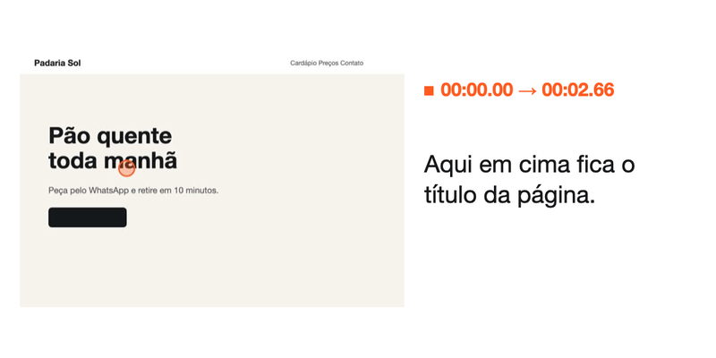
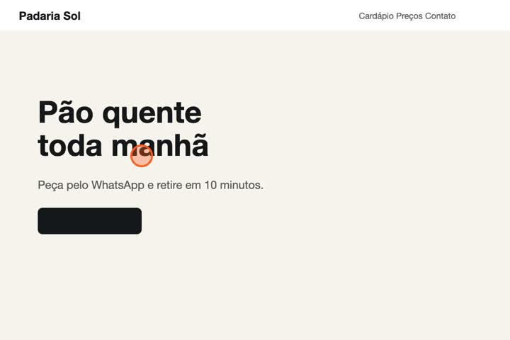
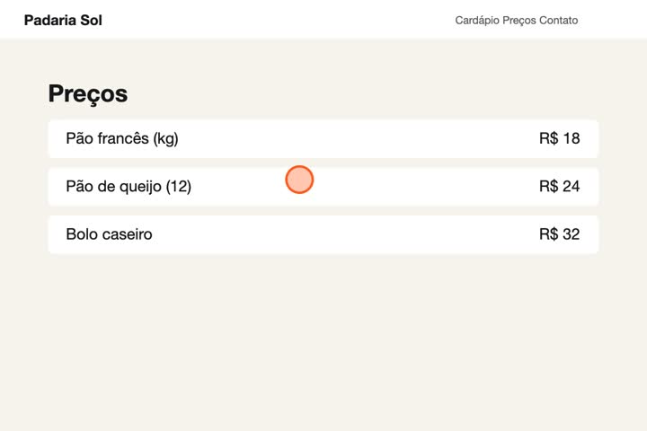
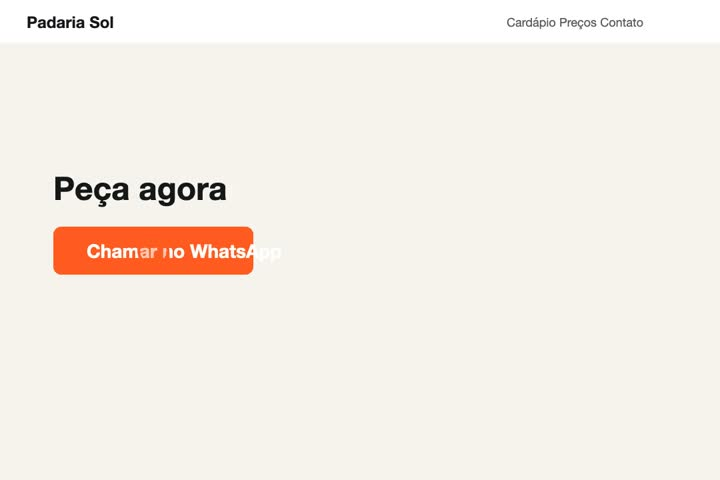

<div align="center">

<picture>
  <source media="(prefers-color-scheme: dark)" srcset="docs/marca/ouvecena-escuro.svg">
  
</picture>

### Vídeo para texto com tempo e imagem, de graça e sem internet

Grave a tela falando e apontando. A IA recebe cada fala junto com o quadro que estava na tela naquele momento.

<a href="#instalar"></a>

[](https://github.com/LimaJoota/ouvecena/stargazers)
[](LICENSE)



</div>

## Instalar

Precisa de um Mac com chip Apple (M1 ou mais novo) e do [Homebrew](https://brew.sh).

```bash
git clone https://github.com/LimaJoota/ouvecena.git
cd ouvecena
./instalar.sh
```

O script instala o `whisper-cpp` e o `ffmpeg` e baixa o modelo de voz (574 MB).

## Usar

Abra o app (`./app.py`, ou crie um atalho com o `Ouvecena.app` descrito abaixo). Uma página abre no navegador. Solte o vídeo nela.

No fim, clique em **Copiar texto para a IA**, cole no chat e arraste as imagens da pasta que **Abrir pasta com os quadros** mostra.

Prefere o terminal?

```bash
./ouvecena video.mov --contexto
```

Saem um `contexto.md` e um quadro por fala. Tudo fica em `~/Ouvecena/`.

## O que ele faz

- **Sem internet.** A voz vira texto no seu Mac e nenhum áudio sai dele.
- **A IA entende o "isso aqui".** Cada fala vem com o quadro do momento, então "sobe isso" deixa de ser mistério.
- **Tempo em tudo.** Cada trecho tem início e fim.
- **Folha de contato.** `--quadros 5` junta um quadro a cada 5 segundos numa imagem só.
- **Corte de faixas.** `--corte "iw:ih*0.36:0:ih*0.32"` tira as barras sobrando da gravação do celular.

<table>
  <tr>
    <td></td>
    <td></td>
    <td></td>
  </tr>
  <tr>
    <td align="center"><sub>"Aqui em cima fica o título"</sub></td>
    <td align="center"><sub>"Tira essa tabela"</sub></td>
    <td align="center"><sub>"Deixa só este botão"</sub></td>
  </tr>
</table>

## Gostou?

Deixe uma estrela. Ela ajuda mais gente a achar o Ouvecena.

<a href="https://star-history.com/#LimaJoota/ouvecena&Date">
  <picture>
    <source media="(prefers-color-scheme: dark)" srcset="https://api.star-history.com/svg?repos=LimaJoota/ouvecena&type=Date&theme=dark">
    
  </picture>
</a>

## Créditos

Feito com [whisper.cpp](https://github.com/ggml-org/whisper.cpp) e [ffmpeg](https://ffmpeg.org). Licença [MIT](LICENSE). Hoje só roda no Mac e o idioma é português do Brasil.
